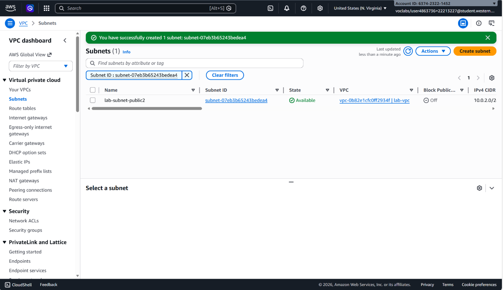
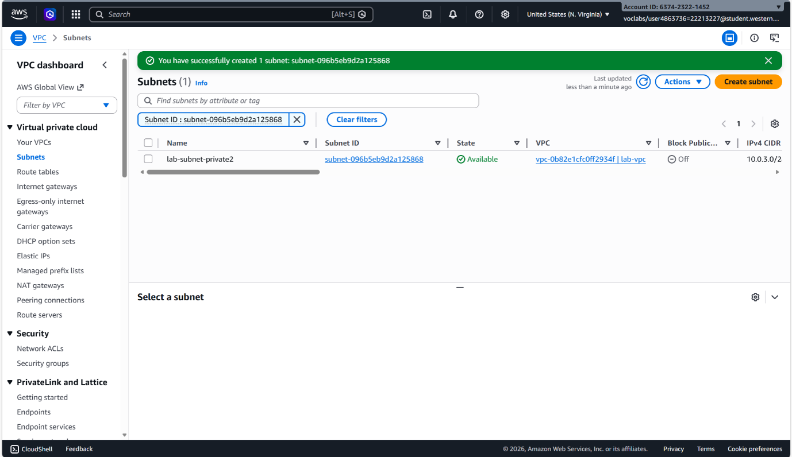
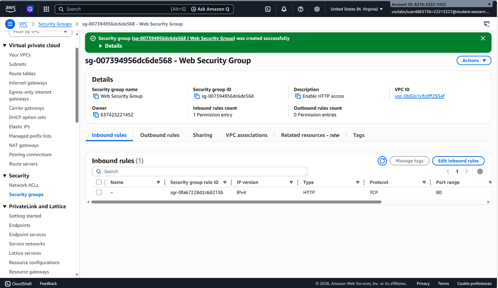

<<<<<<< HEAD

# AWS VPC and EC2 Web Server Deployment

## Project Overview

This project demonstrates the configuration of a
custom Virtual Private Cloud (VPC) and the deployment
of web server infrastructure using AWS Academy.

The project focuses on AWS networking, subnet
segmentation, routing, network security and EC2.

## Project Objectives

- Create a custom AWS VPC.
- Configure public and private subnets.
- Understand Availability Zones.
- Configure Internet Gateway and NAT Gateway.
- Configure route tables and subnet associations.
- Implement EC2 security groups.
- Configure an EC2 web server.

## Technologies and Services

- Amazon VPC
- Amazon EC2
- Public and Private Subnets
- Internet Gateway
- NAT Gateway
- Route Tables
- Security Groups
- AWS Management Console

## Network Configuration

| Component | Configuration |
|---|---|
| VPC CIDR | 10.0.0.0/16 |
| Public Subnet | See implementation screenshots |
| Private Subnet | See implementation screenshots |
| Availability Zones | Two |
| Internet Gateway | Configured |
| NAT Gateway | Configured |
| Web Server | Amazon EC2 |

## Implementation

### 1. VPC Creation

Created a custom VPC using the IPv4 CIDR
block 10.0.0.0/16.

### 2. Subnet Configuration

Configured public and private subnets across
two Availability Zones to support network
segmentation and availability.

### 3. Internet Gateway

Configured an Internet Gateway for
internet connectivity to public subnet resources.

### 4. NAT Gateway

Configured a NAT Gateway to allow resources
in private subnets to initiate outbound
internet communication without direct public
internet exposure.

### 5. Route Tables

Configured subnet associations and routing
to control network traffic.

### 6. Security Groups

Configured a web security group with HTTP
access and restricted SSH access.

### 7. EC2 Web Server

Configured an EC2 instance in the public
subnet with the associated web security group.

## Security Considerations

- Separated public and private network resources.
- Used security groups to control inbound traffic.
- Restricted SSH access to a specific source IP.
- Avoided exposing private resources directly
  to the internet.

## Screenshots

### VPC Configuration

### Public Subnet

### Private Subnet

### Subnet Associations

### Web Security Group

### EC2 Configuration

## Challenges and Learning Outcomes

This lab helped me understand how cloud
networking components work together.

I gained practical knowledge of IP addressing,
subnet segmentation, routing, internet access
and network security in AWS.

## Future Improvements

- Configure CloudWatch monitoring.
- Automate infrastructure using Terraform.
- Implement a highly available web server.
- Configure HTTPS using a suitable architecture.
- Test connectivity and web server availability.

## Project Information

Platform: AWS Academy
Project: Build your VPC and Launch a Web Server
Category: Cloud Computing and Networking

=======
# aws-vpc-ec2-web-server
AWS VPC networking and EC2 web server deployment
>>>>>>> e558ec267181b2ce11c8500ebfaa6ec15716bbb3
